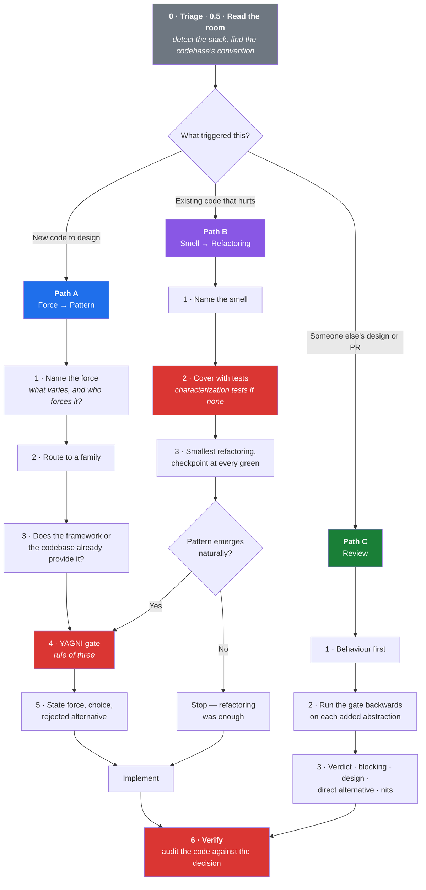

# patterns-and-refactoring

**A Claude Code skill that forces a deliberate design decision before any code gets written, a disciplined, test-backed process before any code gets restructured, and an audit of what was actually built afterwards.**

[](LICENSE)
[](https://docs.claude.com/en/docs/claude-code)
[](#recommended--plugin-from-the-marketplace)
[](#changelog)
[](#installation)
[](#whats-inside)
[](#repository-layout)
[](#whats-inside)

> [!NOTE]
> This skill is **standalone**. It needs no MCP server, no other skill, and no runtime. It is Markdown that changes how the model reasons about design. It ships two ways: as a **plugin** from this repo's marketplace (recommended — versioned, updatable) or as a **plain skill directory** copied into `~/.claude/skills`.

<p align="center"></p>
<p align="center"><sub>A real-time scene built while distilling <a href="skills/patterns-and-refactoring/references/idioms/blender-python.md"><code>idioms/blender-python.md</code></a>: eroded terrain and sky from Blender, with live water, clouds and light in a WebGL shader. Each failure on the way became a checked lesson.</sub></p>

---

## Table of contents

- [The problem](#the-problem)
- [Why this matters now: the legacy modernization wave](#why-this-matters-now-the-legacy-modernization-wave)
- [How it works](#how-it-works)
- [What's inside](#whats-inside)
- [Installation](#installation)
- [Usage](#usage)
- [Repository layout](#repository-layout)
- [Design decisions](#design-decisions)
- [Changelog](#changelog)
- [Contributing](#contributing)
- [Attribution and sources](#attribution-and-sources)
- [License](#license)

---

## The problem

An AI coding assistant, left alone, will write code that works. That is a lower bar than it sounds.

It will also, reliably:

- reach for a pattern because the name fits, not because the problem calls for it
- build an interface with exactly one implementation "for flexibility"
- refactor and change behaviour in the same commit
- restructure code that has no tests, and declare it improved
- hand-roll a Chain of Responsibility next to the framework's own `Pipeline`
- decide "no pattern needed", then ship a generic `CsvWriter` with one caller anyway
- approve a PR labelled "just structure" that swallows exceptions behind eight files of scaffolding
- and, most expensively, produce a design that *reads* sophisticated while making the next change harder

None of this is a knowledge gap. The catalogue is well documented and well represented in training data. It is a **process** gap: the decision of *whether a pattern is warranted at all* gets skipped, because writing the code is more immediately rewarding than justifying its shape.

This skill inserts that decision, and makes it cheap enough to actually happen.

> [!IMPORTANT]
> **"No pattern needed — write the direct code"** is a first-class output of this skill. It is a brake as much as a catalogue. A tool that only ever suggests adding abstraction is not helping.

---

## Why this matters now: the legacy modernization wave

The dominant kind of software work is no longer greenfield. It is **carrying existing systems onto modern stacks** — and pattern literacy is precisely what separates a modernization that pays off from one that reproduces the old design in a new framework.

### The scale of the estate

| Metric | Figure | Source |
|---|---:|---|
| Legacy/application modernization market, 2025 | **~$25–30B** | Aggregate of five research firms ([Pragmatic Coders](https://www.pragmaticcoders.com/resources/legacy-code-stats)) |
| Projected market, 2031–2034 | **$66–90B+** (14.9–17.6% CAGR) | [Mordor Intelligence](https://www.mordorintelligence.com/industry-reports/legacy-modernization-market) |
| COBOL still running in production | **~200–300 billion lines** | [Pragmatic Coders](https://www.pragmaticcoders.com/resources/legacy-code-stats) |
| Average age of a COBOL developer | **~55**, with ~10% of the workforce retiring annually | [Adalo](https://www.adalo.com/posts/b2b-reliance-legacy-coding-languages-stats) |

### What it costs to not deal with it

| Metric | Figure | Source |
|---|---:|---|
| Technical debt as a share of technology estate value | **20–40%** (CIO estimates) | [McKinsey](https://www.mckinsey.com/capabilities/mckinsey-digital/our-insights/tech-debt-reclaiming-tech-equity) |
| Technical debt as a share of IT budget | **~40%**, rising to 60–80% with heavy on-prem estates | [SIG](https://www.softwareimprovementgroup.com/blog/technical-debt-and-it-budgets/) |
| Developer time spent on technical debt | **13.5 of 41.1 hours/week** (≈33%) | [Stripe, *The Developer Coefficient*](https://stripe.com/reports/developer-coefficient-2018) |
| Developer time wasted on bad legacy code | **17.3 hours/week** (self-reported) | Stripe, same report |
| Engineer time freed by paying down debt | **up to 50% more** time on value-generating work | [McKinsey](https://www.mckinsey.com/capabilities/mckinsey-digital/our-insights/tech-debt-reclaiming-tech-equity) |
| SMB IT budget spent "keeping the lights on" | **~70%** | [Synoptek](https://synoptek.com/insights/it-blogs/legacy-system-modernization-cost/) |

<sub>Market-size figures vary meaningfully between research firms and use different scope definitions; treat the ranges as orders of magnitude, not precise measurements. The Stripe figures are self-reported survey data from 2018 and remain the most-cited numbers on developer time allocation.</sub>

### Why a *pattern* skill is the right lever

Roughly a third of global developer effort goes into wrestling existing code, and the single biggest determinant of whether a modernization succeeds is not the target stack. It is whether the team can:

1. **Name what is wrong** — "Shotgun Surgery", not "this code is messy". A named smell carries its own cure.
2. **Establish a safety net before restructuring** — characterization tests, seams, small revertible steps.
3. **Resist redesigning during the port** — migrating behaviour and improving design in the same step means no bisectable failure and no rollback.
4. **Recognise which patterns the new stack already provides** — most modernizations that "add architecture" are reimplementing what the framework ships.
5. **Refuse the big-bang rewrite** — Strangler Fig, one capability at a time, both systems live, delete the old path only at zero traffic.

Those five behaviours are exactly what this skill encodes. AI assistants are now doing a large share of modernization work, and an assistant that will happily restructure an untested legacy module on request is a liability. This skill makes "cover it with tests first" a precondition rather than a suggestion.

> [!WARNING]
> An LLM refactoring untested legacy code is the highest-risk operation in AI-assisted development. It is confident, fast, and has no way to know it broke something. Path B of this skill exists to make that impossible by default.

---

## How it works

One triage gate, three entry paths, one audit at the end.



### Before any path: read the room

> **Consistency with the codebase beats textbook purity.**

Every path starts with two cheap lookups. First, detect the stack from the manifest (`composer.json`, `package.json`, `go.mod`, `Cargo.toml`, `pyproject.toml`, `Gemfile`, `*.csproj`, `pom.xml`), never from file extensions, and open that stack's idioms file. Second, find how *this* codebase already solves this kind of problem (an existing `Actions/`, pipeline, event, job or resolver) and follow it. A second way of doing the same thing is a smell you are introducing. If the existing convention is itself a smell, the decision says so rather than quietly diverging.

Reviewers re-triage on their own: a PR labelled "just structure" gets triaged by what the diff *does*, not what its description says.

### The core rule of Path A

> **Never start from the catalogue.** Browsing 22 patterns for one that fits guarantees a fit.

Start from the problem. Every design pattern answers exactly one question:

> **What is going to change here, and what must stay still while it changes?**

That is the *axis of change*. Name it in plain words before naming any pattern. If you cannot name one, there is no pattern to apply — and the correct design is direct, readable, deletable code.

"No pattern needed" is still a decision, and it gets written down. The **NO-PATTERN** output names what would vary, why it does not vary today, and the trigger that would change the answer. A catalogue "use when" is not a "use now": Strategy lists export formats as a classic fit, and that still does not justify an exporter interface for a ticket with one format.

When someone asks to "make it extensible", the gate stays and the answer changes. You deliver the **seam** instead of the abstraction: split what is stable from what would vary as two plain pieces, name the trigger ("when the second format has a ticket, this becomes a Strategy"), and explain why waiting is safer. An interface designed from one case is exactly the interface the second case cannot satisfy.

### The core rule of Path B

> **Refactoring changes structure, never behaviour.**

If behaviour changes it is a rewrite, and it needs its own tests, its own review, and its own commit. Tests come first, always. When they do not exist, characterization tests come first — pinning what the code does *today*, bugs included.

Existing tests get **run**, and the result is shown: "the suite is probably green" is not a result. If no runner is installed, a plain script that runs the pinned cases and exits non-zero on drift counts as the safety net. A bug found mid-refactor stays pinned; it is fixed afterwards in its own commit, and the pinned expectation moves in that same commit.

Deadline pressure does not create a third option. If pinning the behaviour costs less than the refactoring, pin it and refactor. If it costs more than the deadline allows, **do not refactor**: ship the change with Sprout or Wrap Method and schedule the cleanup. Adding a feature to messy code is *preparatory refactoring*: make the change easy in its own commits, then make the easy change in another.

### The core rule of Path C

> **Behaviour outranks design, and a request to remove an abstraction comes with the smaller shape.**

A review re-triages the diff independently — "just structure" PRs routinely hide behaviour — reads for what fails before what is ugly, then runs the YAGNI gate backwards on every interface, factory, wrapper and DTO the author added. Each finding names the anti-pattern or smell and ends with a sketch of the direct version, sized.

### The rule that closes every path

> **The decision was made before the code. The damage happens during it.**

Step 6 audits the diff against the decision with numbers, not impressions: interfaces added versus implementations, generic components versus consumers, new files versus triage level, whether the rejected alternative crept back in, and whether the tests exercise the axis of change. The audit is expected to fail about one time in three; one that only ever says "all good" is not being run.

### Proportionality

The gate is scaled so it does not become bureaucracy:

| Level | Trigger | Output |
|---|---|---|
| 🟢 **TRIVIAL** | One-line fix, config value, copy change | **Nothing.** The skill steps aside |
| 🟡 **STANDARD** | New service, endpoint, component, small refactor | 2–4 lines: force → choice → rejected alternative — or NO-PATTERN with its trigger |
| 🔴 **ARCHITECTURAL** | New module, package, cross-cutting refactor | A `Pattern Decisions` section with a diagram and rejected alternatives |

---

## What's inside

Twelve catalogues, cross-referenced, with original commentary focused on **cost** and **when not to use it** — the two things pattern references usually omit and the two that actually prevent bad decisions.

| Catalogue | Entries | Reference file |
|---|---:|---|
| Gang of Four patterns | 22 + Interpreter | [`gof-catalog.md`](skills/patterns-and-refactoring/references/gof-catalog.md) |
| Refactoring techniques | 66 + modern additions | [`refactoring-techniques.md`](skills/patterns-and-refactoring/references/refactoring-techniques.md) |
| Code smells | 22 in 5 groups | [`code-smells.md`](skills/patterns-and-refactoring/references/code-smells.md) |
| Enterprise patterns (PoEAA) | ~50 | [`enterprise-patterns.md`](skills/patterns-and-refactoring/references/enterprise-patterns.md) |
| Cloud & distributed patterns | 44 Azure + resilience | [`distributed-patterns.md`](skills/patterns-and-refactoring/references/distributed-patterns.md) |
| Messaging / integration (EIP) | 65 | [`distributed-patterns.md`](skills/patterns-and-refactoring/references/distributed-patterns.md#messaging-and-integration) |
| Architectural patterns | Layering, topologies, multi-tenancy | [`architectural.md`](skills/patterns-and-refactoring/references/architectural.md) |
| Domain-Driven Design | Strategic + tactical | [`ddd-patterns.md`](skills/patterns-and-refactoring/references/ddd-patterns.md) |
| Application security | Trust boundaries, access models, tenant isolation, secrets | [`security-patterns.md`](skills/patterns-and-refactoring/references/security-patterns.md) |
| Data evolution | Online schema change, backfills, stored formats | [`data-evolution.md`](skills/patterns-and-refactoring/references/data-evolution.md) |
| Delivery | Deploy order, workers, flags, rollout, rollback | [`delivery-patterns.md`](skills/patterns-and-refactoring/references/delivery-patterns.md) |
| API design | Resources, versioning, idempotency, contracts | [`api-design.md`](skills/patterns-and-refactoring/references/api-design.md) |

Plus seven files that exist to keep the rest honest:

| File | Purpose |
|---|---|
| [`decision-templates.md`](skills/patterns-and-refactoring/references/decision-templates.md) | The exact shape of every output — NO-PATTERN, STANDARD (both paths), ARCHITECTURAL as a lightweight ADR, the review, the verification report — each with a worked example |
| [`verification.md`](skills/patterns-and-refactoring/references/verification.md) | The post-implementation audit: abstraction counts, test audit, simplification pass, and the ten shapes that creep into AI-assisted code unannounced |
| [`testing-patterns.md`](skills/patterns-and-refactoring/references/testing-patterns.md) | Which tests each pattern owes, test doubles and when a mock is a design smell, characterization and approval nets, test smells, the honest pyramid |
| [`refactoring-workflow.md`](skills/patterns-and-refactoring/references/refactoring-workflow.md) | Seams, characterization tests, preparatory refactoring, Parallel Change (expand/contract, including schemas), Branch by Abstraction, the Mikado Method, legacy modernization sequencing, and when *not* to refactor |
| [`antipatterns.md`](skills/patterns-and-refactoring/references/antipatterns.md) | Pattern anti-patterns, structural anti-patterns, the ten principles most often cited to justify one, and the pre-flight checklist |
| [`framework-idioms.md`](skills/patterns-and-refactoring/references/framework-idioms.md) | Router + cross-stack table, into **22 per-stack files** covering what your framework already implements — read before hand-rolling anything |
| [`concurrency-patterns.md`](skills/patterns-and-refactoring/references/concurrency-patterns.md) · [`functional-patterns.md`](skills/patterns-and-refactoring/references/functional-patterns.md) · [`frontend-patterns.md`](skills/patterns-and-refactoring/references/frontend-patterns.md) | Domain-specific catalogues |

<details>
<summary><b>Sample entry — what the commentary actually looks like</b></summary>

> ### Singleton
>
> - **Intent** — Ensure a class has one instance and provide a global access point to it.
> - **Force** — Genuinely one shared resource *and* a need for global reach.
> - **Use when** — Almost never in application code.
> - **Do NOT use when** — You want convenient access to a shared service. That is dependency injection, and your container already gives you a single instance without the global.
> - **Cost** — Hidden dependencies, hostile to tests, unsafe under concurrency, and impossible to have two of when requirements change. The two legitimate needs it bundles — *one instance* and *global access* — should be separated: keep the first, refuse the second.

Every entry carries **Cost** and **Do NOT use when**. That is the point of the catalogue.

</details>

<details>
<summary><b>Context cost — how this stays cheap</b></summary>

`SKILL.md` is the routing layer and the only file loaded when the skill triggers (about 28 KB, roughly 7,000 tokens). The 20 reference files and 22 stack files are loaded **on demand**, one at a time, once the relevant family is already narrowed.

A typical STANDARD-level decision loads `SKILL.md`, the stack's idioms file, and at most one catalogue. An ARCHITECTURAL decision may load two or three. The full corpus is never loaded at once, and never sits in your context between tasks.

</details>

---

## Installation

Two routes. **The plugin is the recommended one** — it is versioned, updates with a single command, and needs no clone. The manual routes stay supported for anyone who prefers a raw skill directory.

> [!NOTE]
> **Cross-platform.** The skill executes nothing — it is plain Markdown read by the model, so it behaves identically on Linux, macOS and Windows. The installers and the plugin are both conveniences; copying the directory by hand works everywhere.

### Recommended — plugin from the marketplace

Inside Claude Code:

```
/plugin marketplace add christianpasinrey/patterns-and-refactoring
/plugin install patterns-and-refactoring@christianpasinrey
```

Or from a terminal:

```bash
claude plugin marketplace add christianpasinrey/patterns-and-refactoring
claude plugin install patterns-and-refactoring@christianpasinrey
```

The plugin installs the skill at **user scope** (every project). Use `--scope project` to commit it to a repo's `.claude/settings.json` so the whole team gets it, or `--scope local` for a machine-local, uncommitted install.

Verify with `/plugin` or:

```bash
claude plugin details patterns-and-refactoring
```

The skill shows up as `patterns-and-refactoring` and can be invoked explicitly as `/patterns-and-refactoring:patterns-and-refactoring`.

**Updating:**

```bash
claude plugin marketplace update christianpasinrey
claude plugin update patterns-and-refactoring
```

Updates land only when the `version` field is bumped in the release — a pinned version means no surprise changes mid-session.

**Uninstalling:**

```bash
claude plugin uninstall patterns-and-refactoring
claude plugin marketplace remove christianpasinrey
```

### Global — Linux / macOS / Git Bash

```bash
git clone https://github.com/christianpasinrey/patterns-and-refactoring.git
cd patterns-and-refactoring
./install.sh
```

### Global — Windows PowerShell

```powershell
git clone https://github.com/christianpasinrey/patterns-and-refactoring.git
cd patterns-and-refactoring
.\install.ps1
```

### Manual

```bash
# Global: available in every project
mkdir -p ~/.claude/skills
cp -r skills/patterns-and-refactoring ~/.claude/skills/

# Or per-project
mkdir -p .claude/skills
cp -r skills/patterns-and-refactoring .claude/skills/
```

```powershell
# Windows PowerShell — global
New-Item -ItemType Directory -Force "$HOME\.claude\skills" | Out-Null
Copy-Item skills\patterns-and-refactoring "$HOME\.claude\skills\patterns-and-refactoring" -Recurse -Force
```

> [!IMPORTANT]
> The `mkdir -p` is not optional. If `~/.claude/skills` does not exist yet, `cp -r` creates it *as a copy of the skill folder* — `SKILL.md` and `references/` land loose in `skills/` and Claude Code will not detect the skill. The correct result is:
>
> ```
> ~/.claude/skills/patterns-and-refactoring/SKILL.md
> ~/.claude/skills/patterns-and-refactoring/references/
> ```
>
> If you already hit this, remove the stray `SKILL.md` and `references/` from `~/.claude/skills/` before reinstalling.

Verify with `/skills` inside Claude Code — `patterns-and-refactoring` should be listed.

### Optional: guarantee the trigger

Skills are invoked at the model's discretion based on their `description`. To make invocation non-negotiable, add the contents of [`CLAUDE.md.snippet.md`](CLAUDE.md.snippet.md) to your global `~/.claude/CLAUDE.md`:

```markdown
## Design decisions — mandatory gate

Before designing or writing any non-trivial code, before any refactor, and
when reviewing a design or a pull request, invoke the `patterns-and-refactoring`
skill.

- TRIVIAL work (one-line fixes, config values, copy changes, bug fixes that
  introduce no abstraction) is explicitly exempt. Do not invoke the skill and
  do not narrate a decision for it.
- For everything else, state the force (or the smell), the choice made, and the
  alternative rejected — before writing code, not after. "No pattern needed"
  is a decision and gets stated too.
- Never refactor code that has no test coverage without first writing
  characterization tests that pin current behaviour.
- Never refactor and change behaviour in the same commit.
- After implementing, run the skill's verification audit (Step 6) and report
  it, including when it finds nothing to change.
```

> [!TIP]
> Without the `CLAUDE.md` entry the skill still triggers, but only when the model judges the work to be design-relevant — which it will occasionally get wrong on tasks that look trivial and are not. The snippet makes it deterministic.

---

## Usage

Once installed, it works without being asked for. Some examples of what changes:

<details>
<summary><b>Before / after — a STANDARD-level decision</b></summary>

**Prompt:** *"Add support for sending notifications by SMS as well as email."*

**Without the skill:**
> Creates `NotificationService` with a `match` on channel, or immediately builds an abstract factory with a channel registry — depending on how the prompt lands.

**With the skill:**
> **Force:** notification channels vary per user preference, chosen at runtime; the sending call site must not change.
> **Pattern:** Strategy, resolved through the container by channel key.
> **Rejected:** a `match` in the sender — three channels exist today and a fourth is on the roadmap, so the branch would keep growing at a single call site.
> **Framework check:** Laravel already has this — extending the `Notification` channel system rather than building a parallel resolver.

</details>

<details>
<summary><b>Before / after — a refactor request on legacy code</b></summary>

**Prompt:** *"This OrderProcessor class is a mess, clean it up."*

**Without the skill:**
> Rewrites the class. Behaviour may or may not survive. No tests were run because none existed.

**With the skill:**
> **Smells identified:** Large Class (1,400 lines, 6 reasons to change), Long Method (`process()` at 280 lines), Primitive Obsession (`float $amount`, `string $currency`), Switch Statements (status branching repeated in 4 methods).
> **Blocker:** no test coverage. Writing characterization tests against the current behaviour first — pinning what it does today, bugs included.
> **Then, smallest first:** Extract Method on `process()` → Replace Nested Conditional with Guard Clauses → Extract Class for the pricing responsibility. Commit at every green point.
> **Pattern deferred:** the status branching wants Replace Type Code with State/Strategy, but that goes through the YAGNI gate after the mechanical refactorings land.

</details>

<details>
<summary><b>Before / after — "make it extensible" (NO-PATTERN)</b></summary>

**Prompt:** *"Add a CSV export of orders to the admin panel. Make it extensible — we might want Excel at some point."*

**Without the skill:**
> Creates an `ExporterInterface`, a `CsvExporter`, an `ExporterFactory` keyed by format, and a `config/exports.php` with one entry. The factory has one branch.

**With the skill:**
> **Force:** none today. One format, one consumer. "Excel at some point" has no ticket.
> **Choice:** direct code. The orders query and the row formatting (`rowFor(Order)`) are two plain methods of the controller action. That split is the seam.
> **Becomes a pattern when:** a second format has a ticket → Strategy over the writer, designed from both real formats.
> **Extensibility, answered:** the seam already sits where the interface would go. An interface shaped around CSV today is the one Excel would not fit.

</details>

<details>
<summary><b>Before / after — reviewing a pull request</b></summary>

**Prompt:** *"Review PR #412 — it's just structure, quick approve please, standup in 15 minutes."* The PR adds a repository interface with one implementation, a channel strategy factory that ignores its argument, a DTO for an internal call and a static singleton, around a welcome-email service.

**Without the skill:**
> A list of observations of varying weight, in the order the files were read. Whether the swallowed `\Throwable` is mentioned before the naming nits depends on the run. The direct alternative may or may not appear.

**With the skill:**
> **Verdict:** request changes — two silent-failure bugs, and eight files of scaffolding for a behaviour the framework already ships.
> **Blocking (behaviour):** `catch (\Throwable) {}` hides a null-user dereference and any mail failure; no container binding for the interface.
> **Design**, one section per justification the author gave: *"so we can swap the ORM later"* → one implementation, returns Eloquent models, cannot deliver the swap it promises. *"so adding SMS is trivial"* → `Notification::via()` already is that Strategy. *"reachable from anywhere"* → that is the part to refuse.
> **The direct alternative:** three files, ~25 lines — enum cast, queued `WelcomeNotification`, `onboard(User $user)` — with its force and rejected line.
> **Nits**, labelled as nits.

</details>

<details>
<summary><b>What the verification step catches</b></summary>

**Task:** the CSV export above, decided as NO-PATTERN.

**What got written anyway:** an `OrdersExport` class holding the query, a `CsvExport` class "that knows nothing about orders" with one consumer, a controller, two test files, a view — seven files for a download button.

**Step 6 audit:**
> **Audit:** 0 interfaces; 7 files for a STANDARD decision; `CsvExport` has one consumer.
> **Simplified:** writer inlined into the controller method, `rowFor(Order)` kept as the seam. Three files.

The decision was right. The code drifted from it while being typed. That is what the audit exists for.

</details>

You can also invoke it explicitly:

```
/patterns-and-refactoring
```

Or point it at a decision directly: *"Use patterns-and-refactoring to decide how to structure the import pipeline."*

---

## Repository layout

```
patterns-and-refactoring/
├── README.md
├── LICENSE
├── CLAUDE.md.snippet.md          # optional mandatory-invocation gate
├── install.sh                    # POSIX installer (plain-skill route)
├── install.ps1                   # Windows installer (plain-skill route)
├── scripts/validate.py           # links, anchors, frontmatter, manifests
├── evals/                        # behaviour scenarios and how to run them
├── .claude-plugin/
│   ├── plugin.json               # plugin manifest — repo root *is* the plugin
│   └── marketplace.json          # marketplace catalogue — repo root *is* the marketplace
└── skills/
    └── patterns-and-refactoring/
        ├── SKILL.md              # routing layer — the only always-loaded file
        └── references/
            ├── decision-templates.md    # output shapes + worked examples
            ├── verification.md          # post-implementation audit
            ├── testing-patterns.md      # what tests each pattern owes
            ├── gof-catalog.md
            ├── architectural.md
            ├── enterprise-patterns.md
            ├── ddd-patterns.md
            ├── distributed-patterns.md
            ├── concurrency-patterns.md
            ├── functional-patterns.md
            ├── frontend-patterns.md
            ├── security-patterns.md
            ├── data-evolution.md
            ├── delivery-patterns.md
            ├── api-design.md
            ├── code-smells.md
            ├── refactoring-techniques.md
            ├── refactoring-workflow.md
            ├── antipatterns.md
            ├── framework-idioms.md      # router + cross-stack table
            └── idioms/
                ├── laravel-php.md · symfony-php.md
                ├── django-python.md · fastapi-python.md · flask-python.md
                ├── spring-java.md · quarkus-micronaut-java.md · kotlin-ktor.md
                ├── dotnet-csharp.md · efcore-dotnet.md · blazor-dotnet.md
                ├── node-typescript.md · rails-ruby.md · go.md · rust.md
                ├── vue-typescript.md · react-typescript.md
                ├── angular-typescript.md · svelte-typescript.md
                ├── flutter-dart.md · swift-ios.md
                └── blender-python.md
```

---

## Design decisions

Why the skill is built this way. These were deliberate, and each has a rejected alternative.

<details>
<summary><b>Why routing-by-force instead of a pattern index</b></summary>

A pattern index optimises for *lookup*, which is not the failure mode. The model already knows what a Decorator is. It fails at deciding whether one is warranted.

Routing by axis of change forces the diagnosis before the prescription, and makes "no pattern" a first-class outcome rather than an unstated option.

**Rejected:** an alphabetical catalogue with links. Faster to write, and it would have amplified exactly the behaviour the skill exists to prevent.

</details>

<details>
<summary><b>Why a three-level triage instead of always applying</b></summary>

A gate that fires on every task gets abandoned within a week — by humans and by models. Exempting trivial work explicitly is what keeps the process credible on the work that matters.

**Rejected:** always-on justification. Tested informally and it produces exactly the noise that trains people to skim past it.

</details>

<details>
<summary><b>Why <code>SKILL.md</code> stays short</b></summary>

Skill files load in full when triggered. A 6,000-line catalogue in `SKILL.md` would cost context on every design decision, including the ones needing none of it.

Splitting into a thin router plus on-demand references means the common case costs little, and depth is available when the decision earns it.

</details>

<details>
<summary><b>Why "cost" and "do NOT use when" appear in every entry</b></summary>

Pattern references overwhelmingly document intent and structure. Both are already well known to a model trained on the internet. What is systematically missing — from the training data as much as from the references — is the negative space: the conditions under which the pattern is a mistake.

That negative space is the entire value of this skill.

</details>

<details>
<summary><b>Why there is a verification step after the code</b></summary>

The decision gate works. In testing, the model reliably wrote "no pattern needed — direct code" before implementing a CSV export, and then produced a generic writer class with one consumer, a second class holding the query, and seven files. Nothing in the decision was wrong; the abstractions accreted while typing, as they do for humans.

A gate that only runs before the code cannot see that. Step 6 audits the diff against the decision with counts — interfaces versus implementations, consumers per generic component, files per triage level — and expects to find something roughly one time in three.

**Rejected:** trusting the up-front decision. It was the cheaper design, and it was observed not to hold.

</details>

<details>
<summary><b>Why review is its own path</b></summary>

The description always said "reviewing a design" and the model, given a PR to review, improvised: it ran Path A backwards on each abstraction, invented a review layout, and decided by itself whether the swallowed exception came before the naming nits. It did well, and did it differently every time.

Path C fixes the order — behaviour first, then one section per justification the author gave, then the direct alternative sized in files, then nits — because a review missing the direct alternative is criticism without a request, and one that leads with design over a silent-failure bug has its priorities wrong.

**Rejected:** leaving review to the general-purpose code-review tooling. That tooling finds bugs well; it does not ask whether the interface has a second implementation.

</details>

<details>
<summary><b>Why it has no dependencies</b></summary>

The skill slots between "requirements are settled" and "code gets written". Anything that couples it to a specific plugin, workflow, or toolchain narrows where it can be used for no gain. It is Markdown; it composes with whatever process you already run.

The plugin packaging does not change this: the plugin is a distribution wrapper around the same `skills/patterns-and-refactoring/` directory. Copying that directory by hand still works and always will.

</details>

<details>
<summary><b>Why the repo root is both the plugin and the marketplace</b></summary>

Claude Code discovers a plugin's `skills/` directory automatically, so the existing layout already *is* a valid plugin — it only needed `.claude-plugin/plugin.json`. Adding `.claude-plugin/marketplace.json` alongside it, with the plugin entry pointing at `"./"`, makes the same repository the catalogue.

The result: one repo, one clone, one source of truth. `install.sh`, the manual copy, and `/plugin install` all serve the same files.

**Rejected:** a separate marketplace repository, or a `plugins/patterns-and-refactoring/` subdirectory with a duplicated copy of the skill. Both add a sync obligation between two copies of the same Markdown, which is exactly the kind of drift the skill tells you to design away.

</details>

---

## Changelog

### 1.2.1 — 2026-10-31

- `idioms/blender-python.md`: lessons on natural terrain and long headless jobs, from a second round on the showcase scene.

### 1.2.0 — 2026-10-31

**Renamed.** Repository and plugin are now `patterns-and-refactoring`, the name the skill already had, so the project no longer reads as affiliated with refactoring.guru. GitHub redirects the old URL, but the plugin id changed:

```bash
claude plugin uninstall refactoring-guru
claude plugin marketplace update christianpasinrey
claude plugin install patterns-and-refactoring@christianpasinrey
```

**Changed**

- Step 6 now requires two more lines: each requested item mapped to its proof, and how new tests were seen failing. On the `requirement-coverage` scenario 1.1.1 failed 2 of 2 runs and this version passed 2 of 2.
- The decision's Framework line names the `idioms/` file that was opened.
- The verification report is five lines instead of three.

**Added**

- Twelve per-stack files: Symfony, FastAPI, Flask, Quarkus and Micronaut, Kotlin and Ktor, EF Core, Blazor, Angular, Svelte, Flutter, Swift, and Blender.
- Four catalogues: security, data evolution, delivery, and API design.
- `evals/` with four scenarios, `scripts/validate.py`, and CI running the validator.

**Fixed**

- `dotnet-csharp.md` presented the EF Core in-memory provider as a way to test real query translation.
- A broken link in `verification.md`.

### 1.1.1 — 2026-09-14

Documentation only; the skill itself is unchanged.

- README brought in line with 1.1.0: Step 0.5, NO-PATTERN and the "make it extensible" answer, the Path B test and deadline rules, a NO-PATTERN before/after example, and this changelog.
- The `CLAUDE.md` snippet shown in the README now matches [`CLAUDE.md.snippet.md`](CLAUDE.md.snippet.md).

### 1.1.0 — 2026-09-10

The gate used to run only before the code. Clean-context runs on three fixture scenarios exposed the two most expensive gaps. First, a correct "no pattern needed" decision was implemented as seven files anyway. Second, reviews were improvised differently on every run.

**New**

- **Path C — review.** Behaviour first, the YAGNI gate run backwards on each added abstraction, then the direct alternative sized in files, then nits.
- **Step 6 — verification.** A post-implementation audit on every path, with counts: interfaces versus implementations, consumers per generic component, files per triage level, the rejected alternative left out, and tests that exercise the axis of change.
- **Step 0.5 — read the room.** Detect the stack from the manifest, then follow how the codebase already solves the problem.
- **NO-PATTERN** as an explicit, written output, plus the "make it extensible" answer: deliver the seam and name the trigger.
- New references: [`decision-templates.md`](skills/patterns-and-refactoring/references/decision-templates.md), [`verification.md`](skills/patterns-and-refactoring/references/verification.md), [`testing-patterns.md`](skills/patterns-and-refactoring/references/testing-patterns.md).

**Extended**

- Path B: deadline pressure versus tests, settled as one rule plus a table of rationalizations. Tests must actually run, and a plain script counts when no runner exists. Bugs found mid-refactor are pinned, then fixed in their own commit.
- `refactoring-workflow.md`: preparatory refactoring, Parallel Change (including schema expand/contract), Branch by Abstraction, and checkpoint granularity.
- `refactoring-techniques.md`: Extract Method traps (return-type coercion, tighter parameter types).
- `antipatterns.md`: misapplied principles, the utility dumping ground, the boolean parameter trap, soft-coding.
- `idioms/laravel-php.md`: `Notification::via()` as the channel Strategy, Livewire and Inertia specifics, `lazyById` ordering and cursor buffering, `match` and its `===` semantics.
- The skill `description` and the [`CLAUDE.md` snippet](CLAUDE.md.snippet.md) now also trigger on reviews and require the Step 6 audit.

**Fixed**

- A stale link in `enterprise-patterns.md` left over from the move from 2 stacks to 10.

> [!NOTE]
> Plugin users: run `claude plugin marketplace update christianpasinrey` and then `claude plugin update patterns-and-refactoring`. Manual installs: pull and re-run the installer, or copy the directory again.

### 1.0.0 — 2026-08-12

- First plugin release: the repo root is both the plugin and a self-hosted marketplace.
- Paths A and B, the three-level triage, 8 catalogues, and framework idioms for 10 stacks.

---

## Contributing

Contributions welcome, with one editorial constraint:

> Every pattern entry must document **what it costs** and **when not to use it.**

An entry describing only intent and structure will be asked for revision. That is the house style and the reason the skill is useful.

Useful contributions:

- [x] ~~Framework idioms for the major server, frontend and mobile stacks~~ — 22 stacks covered
- [ ] Framework idioms for stacks not yet covered (Elixir/Phoenix, Unity, Godot, Android)
- [ ] Eval scenarios that fail on the current skill: a failing scenario is the strongest kind of contribution
- [ ] Additional anti-patterns with concrete symptoms and cures
- [ ] More worked examples in `decision-templates.md`, especially ARCHITECTURAL ones from non-PHP stacks
- [ ] Shapes the verification audit misses — open an issue with the diff it let through
- [ ] Corrections — particularly where a "do NOT use when" is wrong or too absolute, or where a framework idiom is out of date

Open an issue before a large addition so the scope can be agreed first.

### Releasing

Plugin users only receive changes when the version is bumped. For a release:

1. Bump `version` in **both** `.claude-plugin/plugin.json` and the plugin entry in `.claude-plugin/marketplace.json` — they must agree.
2. Add an entry to the [Changelog](#changelog) and update the version badge at the top of this README.
3. Validate: `python scripts/validate.py` and `claude plugin validate . --strict`. For behaviour changes, run the affected scenarios in [`evals/`](evals/README.md) against the previous version.
4. Tag and push: `claude plugin tag .` creates `patterns-and-refactoring--v<version>` after re-checking that both manifests match.

---

## Attribution and sources

> [!IMPORTANT]
> This project is **not affiliated with, endorsed by, or connected to refactoring.guru** or Alexander Shvets. The pattern and refactoring taxonomies follow that site's well-known structure and are credited here. All text in this skill is **original writing** — no content is reproduced from refactoring.guru or any other source.

For illustrated explanations, full code examples in PHP and 8 other languages, and the definitive presentation of the catalogue, go to the source: **<https://refactoring.guru>**.

Taxonomies and catalogues referenced:

| Source | Contribution |
|---|---|
| [refactoring.guru](https://refactoring.guru) — Alexander Shvets | Pattern, code smell and refactoring technique taxonomy |
| *Design Patterns* — Gamma, Helm, Johnson & Vlissides (1994) | The 23 original patterns |
| *Refactoring* — Martin Fowler (1999, 2nd ed. 2018) | Refactoring catalogue and code smells |
| [*Patterns of Enterprise Application Architecture*](https://martinfowler.com/eaaCatalog/) — Martin Fowler | Enterprise catalogue |
| *Working Effectively with Legacy Code* — Michael Feathers | Seams, characterization tests, sprout & wrap |
| *xUnit Test Patterns* — Gerard Meszaros · *Unit Testing Principles* — Vladimir Khorikov | Test doubles, test smells |
| *Refactoring Databases* — Scott Ambler & Pramod Sadalage · Fowler on [Parallel Change](https://martinfowler.com/bliki/ParallelChange.html) and [Branch by Abstraction](https://martinfowler.com/bliki/BranchByAbstraction.html) | Expand/contract, schema refactoring, in-place replacement |
| *Domain-Driven Design* — Eric Evans | Strategic and tactical DDD |
| [*Cloud Design Patterns*](https://learn.microsoft.com/azure/architecture/patterns/) — Microsoft | 44 cloud patterns |
| [*Enterprise Integration Patterns*](https://www.enterpriseintegrationpatterns.com) — Hohpe & Woolf | 65 messaging patterns |
| *Release It!* — Michael Nygard | Circuit Breaker, Bulkhead, stability anti-patterns |
| *The Mikado Method* — Ellnestam & Brolund | Large-refactoring methodology |

---

## License

[MIT](LICENSE) — use it, fork it, adapt it to your stack.

The referenced books and websites remain the property of their respective authors. This skill contains original commentary on publicly documented taxonomies; it is not a substitute for reading them.
