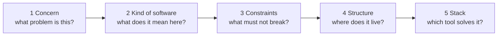

# Decision matrix

The same problems recur in every kind of software. Identity exists in a web app, a CLI, a kernel
driver and a game server; what changes is what it means there, where it lives and which tool
solves it. This file separates those questions so one decision can be made in any setting.



Work left to right. A label decides nothing on its own: "hexagonal", "clean" and "onion" describe
close to the same structure, and a folder called `domain/` does not make a project DDD. Judge by
what the code does, then use the label to communicate.

## 1. Concern → role

Name every concern in the request, including the ones it implies. Each has a role, and the role
is what step 4 places. A concern that spans roles is split: validating a shape is Boundary,
validating a business invariant is Rules.

| Role | Holds |
|---|---|
| **Boundary** | Where the outside world enters: it parses, identifies, and translates failures |
| **Rules** | Decisions that stay true whatever the delivery mechanism |
| **Flow** | The sequence of one operation, and where it succeeds or fails as a unit |
| **Effects** | I/O: storage, network, devices, files, messages |
| **Runtime** | What surrounds the code: process model, configuration, scheduling, telemetry |

| Concern | Role | What a senior asks before writing it |
|---|---|---|
| Identity | Boundary | Who is this, who vouches for it, and how does it expire or get revoked? |
| Permission | Rules, enforced at Boundary | Does the answer depend on the object? Does every entry point pass through it? |
| Input validity | Boundary for shape, Rules for meaning | What else can be wrong besides what was reported? Does one bad item stop the rest? |
| Business rules | Rules | Could this be tested with no I/O? Who owns it if two callers disagree? |
| State and persistence | Effects | Who owns this data, and who else reads it while it changes? |
| Consistency | Flow | What must succeed together, and what is left behind on a crash halfway? |
| Side effects | Effects, triggered by Flow | At-least-once or at-most-once? What happens if it fails after the commit? |
| Long or background work | Runtime and Flow | What happens to work in flight during a restart or an update? |
| Concurrency | Runtime | Who else touches this at the same moment, and what is the unit of isolation? |
| Caching | Effects | Who invalidates it, and how wrong may it be, for how long? |
| External systems | Effects | What is the timeout, and what does the user see when it is down? |
| Failure handling | Boundary translates, Flow decides | Which failures are expected? Who hears about the rest? |
| Configuration and secrets | Runtime | Who sets it, can it change without a release, and where would it leak? |
| Observability | Runtime | How would someone learn this broke, and diagnose it without a debugger? |
| Public contract | Boundary | Who depends on this shape that I cannot change? |
| Update and rollout | Runtime | How far does a bad version reach before it is stopped, and how is it undone? |

## 2. Kind of software

The kind changes what a concern means and what a mistake costs. A project can be several kinds:
decide per component.

| Kind | Entry points | Shipping and undo | Usually outranks design |
|---|---|---|---|
| Web backend, API | Requests, webhooks, consumers, schedules | Rolling deploys; old and new run together | Authorization on every path, data under concurrent versions |
| Web frontend | User events, routes, server data | Instant, but tabs stay open on old code | Bundle size, accessibility, stale server state |
| Mobile | Gestures, deep links, push, lifecycle | Store review; old versions live for years | Offline behaviour, battery, backward-compatible APIs |
| Desktop | Windows, files, IPC, OS integration | User-paced updates | Local data migration, startup time, OS permissions |
| CLI | Arguments, stdin, environment, exit codes | Users pin versions; scripts depend on output | Flags and output as contract, exit codes, pipe-friendliness |
| Library, SDK | The public API, called from unknown code | A published version is permanent; change by semver | Compatibility. It leaves logging, configuration and global state to the caller, and stays silent by default |
| Embedded, firmware | Interrupts, buses, sensors | Field update or none; a bad image can brick | Memory, timing, power, recovery from a failed update |
| Game | Input, frame loop, network ticks | Patches; live state and saves persist | Frame budget, allocation in the loop, determinism, save compatibility |
| Data, ML pipeline | Batches, streams, schedules | Rerun over history; models need versions | One bad record must not lose the run, reruns must be idempotent, lineage, reproducibility |
| Infrastructure, platform | Declarations, control loops, operators | Blast radius across every tenant | Idempotent convergence, safe defaults, drift |
| Systems and security software (kernels, drivers, databases, antivirus, EDR) | Syscalls, callbacks, IOCTLs, hostile files and packets | Staged rings; content updates are code and get the same rollout | Crash means a machine down, so it fails safe. Hot-path latency, hostile input isolated from privilege, signed updates |

## 3. Constraints and standards

Ask what must not break here, then let it outrank elegance. Name the constraint in the decision.

| Constraint | Consequence for design |
|---|---|
| **Blast radius** | Stage the rollout, keep a kill switch, and separate data from code paths so a bad update is contained |
| **Hostile input** | Parse in the least privileged place, bound every size, and fuzz the parser |
| **Hard latency or frame budget** | Indirection and allocation are costs in gate 3. Measure on the hot path |
| **Memory or binary size** | Prefer static dispatch and fixed buffers; count what each dependency adds |
| **Safety or regulation** | Traceability and review are requirements, and the regulated process wins over this skill's defaults |
| **Personal or financial data** | Minimise, encrypt, audit, and assume the data outlives the code |
| **Published contract** | Additive change only, or a major version with a migration path |
| **Team size and skills** | A structure nobody can maintain has failed, however correct it is |

Standards are the shared answers for these constraints. Check the one that governs the domain
rather than deriving a rule again:

| Domain | Look at |
|---|---|
| Application and API security | OWASP ASVS, OWASP Top 10, RFC 9700 for OAuth |
| Memory-unsafe languages | SEI CERT C and C++, MISRA where the sector requires it |
| Threats against endpoints | MITRE ATT&CK |
| Payments | PCI DSS |
| Personal data | GDPR, and local equivalents |
| Medical, automotive, aviation | IEC 62304, ISO 26262, DO-178C |
| Accessibility | WCAG |
| Versioning and telemetry | Semantic Versioning, OpenTelemetry |

## 4. Structure → where each role lives

Recognise the structure by the middle column, not by names. Existing structure wins: follow it,
and adding a place the project does not have is a decision to justify, not a default.

| Structure | Recognise it by | Boundary | Rules | Flow | Effects |
|---|---|---|---|---|---|
| **Script, transaction script** | One function runs top to bottom | Top of the function | Inline, or a plain helper | The function | Inline |
| **Framework MVC, MTV** | Handlers call models that carry data and behaviour | Controller, view, form | Model methods. No new layer unless the project already has one | The handler | Framework APIs, directly |
| **Layered** | Each layer calls only the one below | Presentation | Business layer | Service layer | Data-access layer |
| **Hexagonal, clean, onion** | Inner code imports no framework and owns its interfaces | Driving adapter, translation only | Domain | Use case | Port plus adapter |
| **DDD tactical** | Aggregates guard invariants and change through methods | Application entry | Aggregate, domain service | Application service, one aggregate per transaction | Repository, domain events |
| **Vertical slices** | One folder per feature, with little shared | The slice's handler | Inside the slice | Inside the slice | Inside the slice, shared only when repeated |
| **CQRS** | Writes and reads use separate models | Commands and queries | Write side only | Command handler | Projections feed the read side |
| **Event sourcing** | State is rebuilt from a stored event log | Command handler | Decide function over past events | Process manager | Outside replay, or replay repeats them |
| **Event-driven** | Producers do not know their consumers | Consumer, which validates | Each consumer's own | Saga or choreography | Idempotent handlers |
| **Modular monolith** | Modules call each other through published APIs | Module API | Inside the owning module | Owning module | Private to the module |
| **Microservices** | Services own their data and deploy alone | Each service, and the gateway for coarse checks | The service that owns the data | Saga, never a distributed transaction | Owned store, outbox for events |
| **Serverless** | One function per trigger, no state between runs | Trigger handler | Plain module the handler calls | Workflow service for long flows | Managed services |
| **MVVM, MVI, unidirectional UI** | Views bind to a state holder | View, events only | View model, reducer or use case | View model | Repository |
| **Pipes and filters, DAG** | Stages pass data forward | First stage, with quarantine for bad records | Pure stage | The DAG | First and last stages |
| **Microkernel, plugin** | A small host loads extensions through a contract | The host's contract | The plugin | The host | Through host services, sandboxed |
| **ECS** | Data sits in components, behaviour in systems | Input systems | Systems | System schedule | Dedicated systems |
| **Actors** | State belongs to one actor and changes by message | Mailbox | Actor behaviour | Supervisor | Child actors |
| **Privileged and user mode split** | A minimal kernel component serves a user-mode service | Callback or IOCTL, validated | User mode where latency allows | Work queues, never long in a callback | Minimal in kernel, fail open or closed by explicit policy |

Mixed or unclear? Say so in the decision, name what you actually saw, and follow the nearest code
that solves the same concern. A structure outside this table still has these five roles: find
where each one lives today.

## 5. Stack → the tool

Each ecosystem already solves most concerns, so look for its answer before writing one. The
per-stack files in [`idioms/`](idioms/) go deeper, and [framework-idioms.md](framework-idioms.md)
routes to them. These are common starting points, not the only option, and the project's existing
choice wins.

| Concern | Spring | ASP.NET Core | Django | Laravel | Rails | Node | Go | Rust |
|---|---|---|---|---|---|---|---|---|
| Identity | Spring Security | Authentication handlers, Identity | `django.contrib.auth` | Guards, Sanctum | `has_secure_password`, Devise | Passport, Auth.js | Middleware, `x/oauth2` | Tower or extractor middleware |
| Permission | `@PreAuthorize` | Policies, `IAuthorizationService` | `has_perm`, DRF permissions | Policies, Gates | Pundit | CASL, NestJS guards | Explicit checks | Explicit checks |
| Validation | Bean Validation | Data annotations, FluentValidation | Forms, serializers | Form Requests | Model validations | Zod | `go-playground/validator` | `serde`, `validator` |
| Consistency | `@Transactional` | `SaveChanges`, transactions | `transaction.atomic` | `DB::transaction` | `transaction do` | The driver's or ORM's transaction | `sql.Tx` | `sqlx::Transaction` |
| Background work | `@Scheduled`, Spring Batch | `BackgroundService`, Hangfire | Celery | Queues | Active Job, Sidekiq | BullMQ | Goroutines plus a queue client | Tokio tasks plus a queue client |

Outside web backends the tool usually comes from the platform: SwiftUI and Jetpack libraries on
mobile, the OS and SDK on desktop and systems software, the engine in a game, the orchestrator
for pipelines. Name the platform's answer the same way.

## Filling the Placement line

```
**Placement:** <concern> in <kind>; <constraint that outranks design, or none>; <structure, with
the evidence you saw> → <where it lives>.
```

One line per concern. Examples, each from a different kind of software:

> **Placement:** input validity in a batch pipeline; one bad record must not lose the run; pipes
> and filters (stages composed in `run.py`) → a pure stage before `normalise`, with anything
> unparsable sent to quarantine with its reason.

> **Placement:** logging in a published library; compatibility; no framework → a hook the caller
> supplies, silent when absent.

> **Placement:** permission in a web backend; none; Django MVC (views call fat models, no service
> layer) → a model method, enforced by the view.

> **Placement:** signature updates in an endpoint security agent; blast radius, a crash takes the
> machine down; privileged and user mode split → parsed in the user-mode service, validated
> before the driver sees it, released through staged rings with a kill switch.

## Sources

Martin Fowler, *Patterns of Enterprise Application Architecture* · Eric Evans, *Domain-Driven
Design* · Alistair Cockburn, Hexagonal Architecture · Mark Richards and Neal Ford, *Fundamentals
of Software Architecture* · Michael Nygard, *Release It!* · Google, *Site Reliability Engineering*
· the standards bodies named above. Original synthesis.
